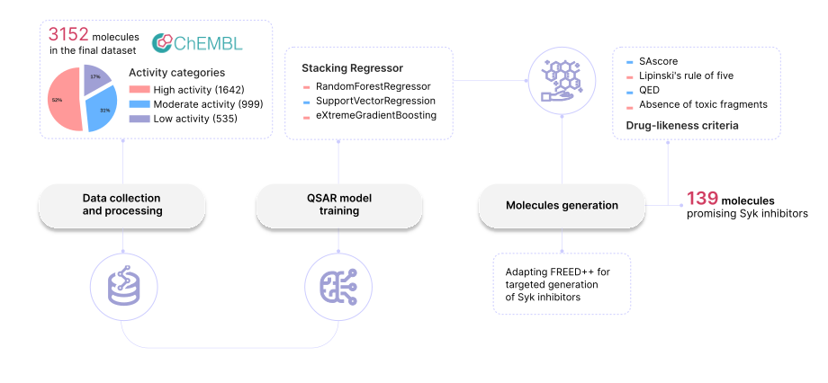

# Syk_inhibitors

---

---

## Overview

## Overview

Focused on discovering molecules that inhibit the Syk kinase, the work combines data analysis and machine learning to accurately predict how well different compounds can block this target. It starts by gathering and cleaning experimental data to ensure reliable information. Various methods are employed to represent the chemical features of molecules, capturing their structural and chemical characteristics comprehensively. Advanced predictive models are then developed and fine-tuned to estimate the inhibitory strength of molecules, enabling fast comparison of different representations and approaches. The tools also support testing new compounds by converting their chemical descriptions into features used by the trained models to predict activity. Additionally, the approach evaluates important drug-like qualities such as safety, ease of synthesis, and potential effectiveness through computational assessments and docking simulations. This integrated framework aids in identifying promising candidates for further development by comparing their properties with known inhibitors and ensuring novelty. Altogether, the effort streamlines the discovery of potential Syk kinase inhibitors, providing a robust, data-driven pipeline that supports the design, evaluation, and selection of new therapeutic molecules.

### Background

**Spleen tyrosine kinase (Syk)** is an intracellular protein expressed in various immune cells, playing a crucial role in inflammatory reactions. Its hyperactivation is associated with numerous autoimmune, allergic, and inflammatory diseases, making Syk an *attractive therapeutic target*.

**Immune thrombocytopenia**, a rare autoimmune disorder, is one condition where new Syk inhibitors are particularly needed. Despite the development of several Syk inhibitors, including the approved drug Fostamatinib, challenges persist in achieving optimal efficacy and safety profiles.

To address these challenges, computational methods and machine learning approaches have been increasingly utilized in drug discovery. This study introduces a novel approach using generative models based on reinforcement learning to obtain novel Syk inhibitor molecules. Moreover, our approach demonstrates a methodology for adapting generative algorithms to design inhibitors against specific therapeutic targets.

## Repository content

## Repository content

The repository 'Syk_inhibitors' is organized into several components that collectively enable the design, evaluation, and prediction of potent spleen tyrosine kinase (Syk) inhibitors.

The core components include:

1. **Data Collection and Processing**
   - Dataset sourced from the open database **ChEMBL** consisting of medicinal molecules.
   - The raw dataset file is `all_mols.csv`.
   - Initial processing includes curation, normalization of inhibitory concentration ($IC_{50}$) values, removal of duplicates and outliers as shown in `Data_processing.ipynb`.
   - Final curated dataset contains 3,176 inhibitor molecules with known $IC_{50}$ values.

2. **Molecular Representations**
   - Various fingerprint and vector-based molecular representations were computed and compared using automated machine learning (PyCaret).
   - Representations include Extended-connectivity fingerprints (ECFPs), Mol2vec, MACCS keys, MAP4, and PubChem fingerprints.
   - ECFPs demonstrated the best performance and the processed dataset with loaded descriptors is in `df_fp.csv`.
   - Analysis of representations is presented in `Molecules_representations.ipynb`.

3. **Predictive Modeling**
   - Implementation and training of predictive regression models to estimate bioactivity (pIC50) using algorithms such as support vector regression, random forests, gradient boosting, and stacking ensembles.
   - Hyperparameter tuning and cross-validation ensure model robustness.
   - Model training is detailed in `Predicted_model.ipynb`.

4. **IC50 Prediction Tool**
   - An interactive tool in `IC50_predictor.ipynb` allows users to predict $IC_{50}$ values from SMILES representations of potential Syk inhibitors.

5. **Inhibitor Generation and Analysis**
   - Molecular libraries are generated using an enhanced generative model (FREED++) integrated with the predictive model, guided by reinforcement learning.
   - Generated molecules are evaluated for drug-like properties, synthetic accessibility, toxicity, and docking scores.
   - Generation evaluation is in `Generation_analysis.ipynb`.

6. **Property Analysis of Promising Inhibitors**
   - Comparison of generated molecules with known ChEMBL inhibitors in terms of physicochemical properties and chemical diversity.
   - Helps ensure novelty and favorable drug-like characteristics.
   - Analysis presented in `Property_analysis.ipynb`.

## Used algorithms

## Used algorithms

The codebase employs several key algorithms to predict and optimize the inhibitory activity of molecules targeting the Syk kinase:

- **Data curation and preprocessing:** Standardize activity measurements ($IC_{50}$), remove duplicates, and exclude outliers to ensure high-quality datasets.

- **Molecular descriptor generation:** Transform chemical structures into numerical representations including Morgan fingerprints (ECFP), Mol2vec embeddings, MACCS keys, MAP4, and PubChem fingerprints, capturing relevant structural and chemical features.

- **Machine learning models:** Utilize classical algorithms such as support vector regression, random forests, gradient boosting, and stacking regressors.

- **Automated machine learning (AutoML):** PyCaret framework facilitates rapid benchmarking and comparison of molecular representations and models.

- **Model optimization:** Hyperparameter tuning and cross-validation enhance prediction accuracy and robustness.

- **Generative modeling:** Use of reinforcement learning-enhanced generative models (e.g., FREED++) guided by QSAR model rewards to design novel inhibitor molecules.

- **Molecular evaluation:** Algorithms assess drug-likeness, synthetic accessibility, toxicity alerts, and docking scores to prioritize promising candidates.

- **Statistical analysis and visualization:** Compare generated molecules with known actives to evaluate property distributions and structural novelty.

These combined algorithms enable a comprehensive pipeline supporting data-driven drug discovery focused on Syk kinase inhibition.